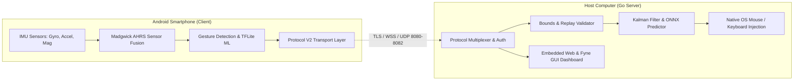
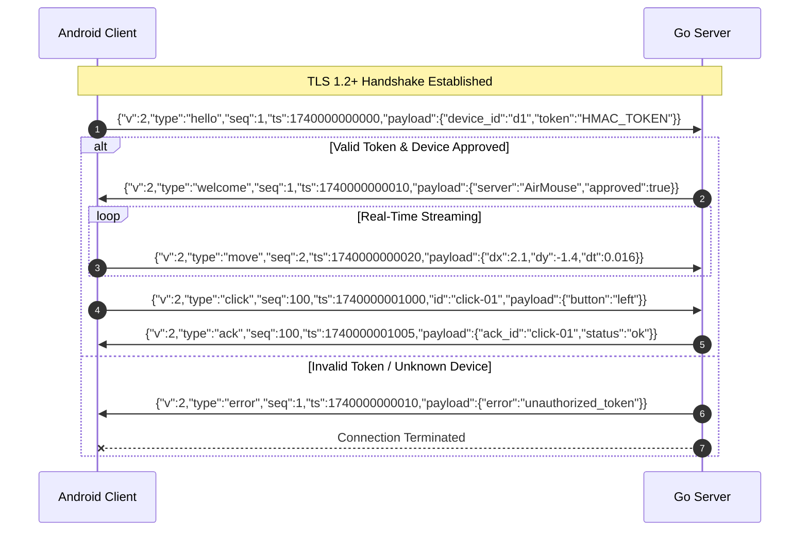

# AirMouse: Master Architecture & Technical Documentation
**Canonical System Reference Document**  
**Version:** 2.0.0-remediated (Release v1.0.0 / Protocol v2.0.0)  
**Status:** Canonical & Frozen  

> [!NOTE]
> **Companion In-Depth Treatises**:
> - [**Deep-Dive Architectural Analysis & Strategic Improvement Roadmap**](docs/ARCHITECTURAL_ANALYSIS_AND_IMPROVEMENT_ROADMAP.md)
> - [**Comprehensive STRIDE Threat Model & Security Controls**](docs/THREAT_MODEL.md)
> - [**Headless, GUI & ONNX Build Guide**](docs/BUILD.md)
> - [**iOS Safari & Mobile Web Client Guide**](docs/WEB_CLIENT.md)

---

## Table of Contents

1. [Executive Overview & System Architecture](#1-executive-overview--system-architecture)
   - [1.1 System Concept & Topology](#11-system-concept--topology)
   - [1.2 High-Level Architecture Diagram](#12-high-level-architecture-diagram)
   - [1.3 Go Desktop Server Architecture](#13-go-desktop-server-architecture)
   - [1.4 Android Mobile Client Architecture](#14-android-mobile-client-architecture)
2. [Communication Protocol V2 (Canonical Contract)](#2-communication-protocol-v2-canonical-contract)
   - [2.1 Wire Envelope Standard](#21-wire-envelope-standard)
   - [2.2 Handshake & Session Lifecycle](#22-handshake--session-lifecycle)
   - [2.3 Complete Message Catalog](#23-complete-message-catalog)
   - [2.4 Reliability, Retransmission & Ordering](#24-reliability-retransmission--ordering)
3. [Build & Deployment Instructions](#3-build--deployment-instructions)
   - [3.1 Headless Build (Zero-CGO)](#31-headless-build-zero-cgo)
   - [3.2 Desktop GUI Build (Fyne & Web Dashboard)](#32-desktop-gui-build-fyne--web-dashboard)
   - [3.3 ONNX Predictive & ML Enhanced Build](#33-onnx-predictive--ml-enhanced-build)
   - [3.4 Containerized Deployment (Docker)](#34-containerized-deployment-docker)
4. [Security Threat Model & Defense-in-Depth](#4-security-threat-model--defense-in-depth)
   - [4.1 Trust Boundaries & Threat Actors](#41-trust-boundaries--threat-actors)
   - [4.2 STRIDE Threat Assessment & Mitigations](#42-stride-threat-assessment--mitigations)
   - [4.3 Input Validation & Replay Defense](#43-input-validation--replay-defense)
5. [Testing Strategy & Quality Assurance](#5-testing-strategy--quality-assurance)
   - [5.1 Server Test Suite & Race Detection](#51-server-test-suite--race-detection)
   - [5.2 Client-Side Sensor & UI Testing](#52-client-side-sensor--ui-testing)
   - [5.3 Protocol Parity & Compliance Verification](#53-protocol-parity--compliance-verification)
   - [5.4 Perfetto Tracing & Real-Time Performance](#54-perfetto-tracing--real-time-performance)
6. [Contributing Guidelines & Project Governance](#6-contributing-guidelines--project-governance)
   - [6.1 Code Standards & Clean Architecture](#61-code-standards--clean-architecture)
   - [6.2 Workflow & Pull Request Checklist](#62-workflow--pull-request-checklist)

---

## 1. Executive Overview & System Architecture

### 1.1 System Concept & Topology
AirMouse is an embedded systems and human-interface platform that transforms an Android smartphone into a high-precision, low-latency spatial remote mouse, gesture controller, and presentation device. The system comprises two primary sub-systems:

- **Mobile Client (Android)**: Fuses inertial measurement units (3-axis gyroscope, 3-axis accelerometer, and 3-axis magnetometer) using the Madgwick AHRS algorithm, detects spatial motions and gestures, executes local machine learning inferences, and streams control events over high-throughput encrypted network transports.
- **Desktop Server (Go)**: A multi-protocol, cross-platform background engine written in Go. It terminates incoming transport connections (WebSocket, TCP, UDP Discovery, Bluetooth HID proxy, USB-CDC serial), validates incoming packets against strict bounds and replay models, applies Kalman and ONNX LSTM trajectory smoothing, and injects OS-level mouse and keyboard events.



### 1.2 High-Level Architecture Diagram

```
┌─────────────────────────────────────────────────────────────────────────────┐
│                       ANDROID SMARTPHONE (CLIENT)                           │
│  ┌──────────────────────┐  ┌──────────────────────┐  ┌───────────────────┐  │
│  │ Motion / Gyro / Accel│  │ Touchpad / Virtual UI│  │ TFLite ML Gestures│  │
│  └──────────┬───────────┘  └──────────┬───────────┘  └─────────┬─────────┘  │
│             │                         │                        │            │
│             ▼                         ▼                        ▼            │
│  ┌───────────────────────────────────────────────────────────────────────┐  │
│  │     Madgwick AHRS Fusion & Exponential Smoothing Pipeline (100 Hz)    │  │
│  └──────────────────────────────────┬────────────────────────────────────┘  │
│                                     │                                       │
│                                     ▼                                       │
│  ┌───────────────────────────────────────────────────────────────────────┐  │
│  │       Protocol V2 Network Engine (Encrypted WSS / TLS / UDP)          │  │
│  └──────────────────────────────────┬────────────────────────────────────┘  │
└─────────────────────────────────────┼───────────────────────────────────────┘
                                      │ Network Wire (JSON-Lines / TLS 1.2+)
                                      ▼
┌─────────────────────────────────────────────────────────────────────────────┐
│                       DESKTOP SERVER (GO PRO SERVER)                        │
│  ┌───────────────────────────────────────────────────────────────────────┐  │
│  │ Protocol Listeners: TCP (8080), WebSocket (8081), UDP Broadcast (8082)│  │
│  └──────────────────────────────────┬────────────────────────────────────┘  │
│                                     │                                       │
│                                     ▼                                       │
│  ┌───────────────────────────────────────────────────────────────────────┐  │
│  │ Security Filter: HMAC Auth, Replay Window (±5s), Bounds Enforcement   │  │
│  └──────────────────────────────────┬────────────────────────────────────┘  │
│                                     │                                       │
│  ┌──────────────────────────────────┴────────────────────────────────────┐  │
│  │ Trajectory Engine: 2D Kalman Filter + ONNX LSTM Neural Smoother       │  │
│  └──────────────────────────────────┬────────────────────────────────────┘  │
│                                     │                                       │
│  ┌──────────────────────────────────┴────────────────────────────────────┐  │
│  │ Native Input Injection: CoreGraphics (macOS) / uinput (Linux) / Win32 │  │
│  └───────────────────────────────────────────────────────────────────────┘  │
└─────────────────────────────────────────────────────────────────────────────┘
```

### 1.3 Go Desktop Server Architecture
The server is structured in accordance with **Clean Architecture** patterns:
- **`cmd/airmouse-server/`**: Server entrypoint, flag parsing, lifecycle management, signal trapping, and component bootstrapping.
- **`internal/protocol/`**: Wire encoders and decoders for Protocol V2, socket engines (TCP, WebSocket, UDP discovery, USB serial, Bluetooth).
- **`internal/device/`**: Device registry, connection session state, pairing lifecycle, client blacklisting/whitelisting.
- **`internal/auth/`**: Cryptographic HMAC token validation, token generation, and secure session management.
- **`internal/proximity/`**: Bluetooth RSSI path-loss fusion and automated screen locking/unlocking engine.
- **`control/mouse/`**: OS-specific hardware cursor controllers (`mouse_darwin.go` via CoreGraphics, `mouse_linux.go` via Linux uinput, `mouse_windows.go` via User32 Win32 API, `mouse_nocgo.go` for zero-CGO builds).
- **`control/predict/`**: Mathematical Kalman filters, dead-reckoning buffers, and ONNX Runtime LSTM predictors (`ai_smoother.go` / `ai_smoother_stub.go`).
- **`web/`**: Single-page modern dashboard embedded into the Go binary via Go 1.16+ `embed.FS`.

### 1.4 Android Mobile Client Architecture
The mobile application uses modern Android Jetpack Compose, Kotlin Coroutines, and MVI (Model-View-Intent) Clean Architecture:
- **Presentation Layer**: 20+ Compose screens (Touchpad, Home, Sensor Visualizer, Calibration Wizard, Gesture Studio, Server Logs, Proximity Settings) observing reactive `StateFlow<UiState>`.
- **Domain Layer**: Pure Kotlin use cases (`SendMovementUseCase`, `CalibrationUseCase`, `DetectGestureUseCase`, `ConnectToServerUseCase`) completely decoupled from Android framework SDKs.
- **Data Layer**: Room SQLite database for persistent historical statistics and device pairings; DataStore preferences for runtime tuning.
- **Infrastructure Layer**: Background foreground services (`SensorService`, `ProximityService`), Madgwick AHRS mathematical filter, and OkHttp WebSocket client.

---

## 2. Communication Protocol V2 (Canonical Contract)

### 2.1 Wire Envelope Standard
All streaming transports (TCP, WebSocket, USB) use newline-delimited JSON (`\n`). Every packet **MUST** encapsulate its contents inside the Protocol V2 canonical envelope:

```json
{
  "v": 2,
  "type": "<string>",
  "seq": 1001,
  "ts": 1740000000000,
  "id": "urn:uuid:f47ac10b-58cc-4372-a567-0e02b2c3d479",
  "payload": { ... }
}
```

#### Envelope Specification:
- **`v`** (integer, mandatory): Protocol version. MUST be `2`. Messages omitting `v` or having `v != 2` are rejected.
- **`type`** (string, mandatory): Message action identifier.
- **`seq`** (uint64, mandatory for streaming sessions): Monotonically increasing sequence number per session.
- **`ts`** (int64, mandatory): Unix epoch timestamp in milliseconds when packet was generated.
- **`id`** (string, optional): Correlation identifier for operations requiring acknowledgment (`ack`).
- **`payload`** (object, mandatory): Strictly typed dictionary containing action parameters. Flat legacy envelopes are rejected with `protocol_v1_deprecated`.

### 2.2 Handshake & Session Lifecycle



### 2.3 Complete Message Catalog

The following table documents all canonical message types verified against the server implementation:

| Message Type | Direction | Delivery Mode | Description |
|--------------|-----------|---------------|-------------|
| `hello` / `device_info` | Client -> Server | Reliable | Initial connection handshake with device fingerprint & HMAC token (accepts alias `device_info`) |
| `welcome` | Server -> Client | Reliable | Handshake confirmation containing server session parameters |
| `move` | Client -> Server | Unreliable (Fast) | Relative cursor displacement (`dx`, `dy`, `dt`) |
| `click` | Client -> Server | Reliable (`ack`) | Mouse button press (`button`: `left`, `right`, `middle`) |
| `mouse_down` | Client -> Server | Reliable (`ack`) | Mouse button press without release |
| `mouse_up` | Client -> Server | Reliable (`ack`) | Mouse button release |
| `doubleclick` / `double_click` | Client -> Server | Reliable (`ack`) | Double left-click convenience command (accepts alias `double_click`) |
| `rightclick` / `right_click` | Client -> Server | Reliable (`ack`) | Right-click convenience command (accepts alias `right_click`) |
| `scroll` | Client -> Server | Reliable (`ack`) | Scroll wheel displacement (`delta`) |
| `key` / `keypress` | Client -> Server | Reliable (`ack`) | Keystroke with modifier array (`key`, `modifiers`) |
| `type` | Client -> Server | Reliable (`ack`) | Direct Unicode text string injection (`text`) |
| `gesture` | Client -> Server | Reliable | Recognized spatial gesture (`gesture`, `confidence`) |
| `proximity` | Client -> Server | Stream | Proximity distance updates (`device_id`, `distance`, `is_near`) |
| `orientation` | Client -> Server | Stream | Raw fused Euler angles (`pitch`, `roll`, `yaw`) |
| `calibration_data` | Client -> Server | Reliable | Sensor calibration biases for gyro, accel, and mag |
| `control` | Client -> Server | Reliable (`ack`) | System controls (`pause_movement`, `lock_screen`, `show_desktop`, etc.) |
| `presentation` | Client -> Server | Reliable (`ack`) | Slide deck navigation (`prev`, `next`, `fullscreen`, `exit`) |
| `media` | Client -> Server | Reliable (`ack`) | Media playback control (`playpause`, `volumeup`, `volumedown`, `stop`) |
| `laser` | Client -> Server | Stream | Virtual presentation laser pointer coordinate overlay |
| `voice_command` | Client -> Server | Reliable | Voice intent transcription from offline speech engine |
| `steering` | Client -> Server | Stream | Game mode steering wheel emulation (`angle`, `throttle`, `brake`) |
| `shooter` | Client -> Server | Stream | Game mode motion aiming and weapon trigger |
| `smarthome` | Client -> Server | Reliable | Smart home trigger event |
| `battery` | Client -> Server | Telemetry | Mobile battery charge state and percentage |
| `log` | Client -> Server | Telemetry | Remote logging forwarder from client to desktop log viewer |
| `status` | Bidirectional | Telemetry | Operational health and active client count |
| `stats` | Server -> Client | Telemetry | Aggregate session statistics (click counts, uptime) |
| `notification` | Server -> Client | Push | Toast/HUD message push to mobile screen |
| `config` | Bidirectional | Reliable | Dynamic runtime configuration sync |
| `custom` | Bidirectional | Extensible | User-defined macro or plugin payloads |
| `file` | Bidirectional | Reliable | Chunked file transfer handshake and progress tracking |
| `ping` | Bidirectional | Keep-Alive | Heartbeat probe |
| `pong` | Bidirectional | Keep-Alive | Heartbeat reply |
| `ack` | Server -> Client | Reliable | Success acknowledgment referencing action `id` |
| `nack` | Server -> Client | Reliable | Command failure or replay rejection notification |
| `error` | Server -> Client | Reliable | Error descriptor (`error` message) |
| `discover` | Client -> Broadcast | UDP Broadcast | Client LAN discovery broadcast (port 8082) |
| `offer` | Server -> Client | UDP Unicast | Server response with instance ID, ports, and TLS fingerprint |

### 2.4 Reliability, Retransmission & Ordering
- **Movement Packets (`move`)**: High-frequency streaming (60-120 Hz). Packet drops are preferred over out-of-order latency spikes. Old sequence numbers (`seq < last_received_seq`) are silently discarded.
- **Control & Action Packets (`click`, `scroll`, `key`, `control`)**: High-reliability actions require immediate `ack` from the server. The client maintains an unacknowledged queue; if no `ack` arrives within 500ms, the packet is retransmitted up to 3 times before entering network recovery.

---

## 3. Build & Deployment Instructions

The AirMouse server codebase is engineered for maximum portability with three distinct compilation targets:

```
┌─────────────────────────────────────────────────────────────────────────────┐
│                            BUILD PROFILES                                   │
│  1. Headless (Zero-CGO)    --> Pure Go, no GUI, minimal footprint, Docker   │
│  2. Desktop GUI (Fyne/Web) --> Native system tray, settings UI & Web UI     │
│  3. ONNX Predictive & ML   --> Neural trajectory smoothing & LSTM predictor │
└─────────────────────────────────────────────────────────────────────────────┘
```

For full compilation details, consult the dedicated [docs/BUILD.md](file:///Users/tahamajs/Documents/uni/CPS/AirMouse/docs/BUILD.md).

### 3.1 Headless Build (Zero-CGO)
Constructs a statically linked server binary with zero C dependencies. Ideal for headless Linux servers, cloud environments, and Docker containers:
```bash
cd pc/airmouse_go_new
CGO_ENABLED=0 go build -tags noai -ldflags "-s -w -X main.version=2.0.0" -o airmouse-server-headless ./cmd/airmouse-server
```
Run with `--headless` to suppress desktop browser launch:
```bash
./airmouse-server-headless --headless --config=config.json
```

### 3.2 Desktop GUI Build (Fyne & Web Dashboard)
Compiles the full interactive desktop application with system tray and browser integration:
```bash
cd pc/airmouse_go_new
CGO_ENABLED=1 go build -ldflags "-X main.version=2.0.0" -o airmouse-server ./cmd/airmouse-server
```
To bundle a macOS `.dmg` installer:
```bash
make dmg-mac
```

### 3.3 ONNX Predictive & ML Enhanced Build
Compiles with real-time neural network inference using Microsoft ONNX Runtime:
```bash
cd pc/airmouse_go_new
CGO_ENABLED=1 go build -tags "ai ml" -ldflags "-X main.version=2.0.0" -o airmouse-server-ai ./cmd/airmouse-server
```
*Requirement:* The native `libonnxruntime` shared library must be in your system library path, and `models/mouse_smoothing.onnx` must be placed in the working directory.

### 3.4 Containerized Deployment (Docker)
```bash
cd pc/airmouse_go_new
docker build -t airmouse/airmouse-server:latest .
docker run -d -p 8080:8080 -p 8081:8081 -p 8082:8082/udp airmouse/airmouse-server:latest
```

---

## 4. Security Threat Model & Defense-in-Depth

### 4.1 Trust Boundaries & Threat Actors
AirMouse accepts remote input from the local network and translates it into physical operating system input events. As such, the attack surface must be rigorously bounded:

- **Untrusted Zone**: Local Area Network (Wi-Fi), potential rogue devices or malicious actors performing packet sniffing or injection.
- **Perimeter Zone**: Network listeners (TCP 8080, WebSocket 8081, UDP 8082).
- **Trusted Zone**: Core input simulator, operating system window manager, and local filesystem configuration.

### 4.2 STRIDE Threat Assessment & Mitigations

| Threat (STRIDE) | Attack Vector | Security Countermeasure |
|-----------------|---------------|--------------------------|
| **Spoofing** | Attacker impersonates authorized mobile device to hijack cursor | Cryptographically random 32-byte pairing secret; HMAC-SHA256 authenticated handshake (`hello`); Bluetooth MAC address allowlist. |
| **Tampering** | Man-in-the-Middle (MITM) modifies motion or click packets | Mandatory TLS 1.2+ encryption (`tls.Listen` and `wss://`). Plaintext sockets are rejected by default. |
| **Repudiation** | Client denies issuing high-privilege system command | Per-session monotonically increasing `seq` logging; detailed audit trail in memory and rotating log files. |
| **Information Disclosure** | Passive eavesdropping on LAN extracts user typing or actions | End-to-end transport encryption with modern cipher suites (ECDHE-ECDSA-AES128-GCM-SHA256). |
| **Denial of Service** | Packet flooding, malformed JSON, NaN/Infinity float injection | Max frame read limit (1 MB); strict coordinate bounds enforcement (`|dx|, |dy| <= 500`); NaN/Inf rejection; rate limiters (120 moves/sec, 20 clicks/sec). |
| **Elevation of Privilege** | Remote command injection via system command payloads | Strictly allowlisted enum actions (`lock_screen`, `show_desktop`); zero shell interpretation; execution as unprivileged local user. |

### 4.3 Input Validation & Replay Defense
1. **Replay Window Filter**: Every packet requires timestamp `ts`. The server enforces `|current_time - ts| <= 5000 ms`. Stale packets are dropped immediately.
2. **Monotonic Sequence Enforcement**: Packets with `seq <= last_received_seq` are dropped to prevent replay attacks on ordered control streams.
3. **Coordinate Bounds**: Delta coordinates are validated: `!math.IsNaN(dx) && !math.IsInf(dx, 0) && math.Abs(dx) <= 500.0`. Values exceeding bounds trigger rate-limited warning and immediate drop.

---

## 5. Testing Strategy & Quality Assurance

AirMouse employs a multi-tiered test harness spanning unit tests, integration verification, sensor mathematical validation, and real-time tracing.

### 5.1 Server Test Suite & Race Detection
The Go server includes unit tests with concurrency race detection across all core packages:
```bash
cd pc/airmouse_go_new
go test -v -race -timeout 30s ./...
```
To generate test coverage reports:
```bash
make test-coverage
```

### 5.2 Client-Side Sensor & UI Testing
- **Madgwick AHRS Convergence**: Validates that 500 static gyro samples converge to zero bias and gravity accurately computes to 9.81 m/s² ±0.05.
- **MVI Compose UI Tests**: Espresso and Compose UI testing for calibration workflows, pairing wizards, and touch gesture recognition.

### 5.3 Protocol Parity & Compliance Verification
To guarantee that no drift occurs between documentation and codebase implementations, the repository includes an automated verification script:
```bash
./scripts/check_docs.sh
```
This script scans all active message types in `internal/protocol/message.go`, `tcp/server.go`, `websocket/server.go`, and validates that each message type and canonical envelope field is fully documented in `docs/PROTOCOL_V2.md` and `DOCUMENTATION.md`.

### 5.4 Perfetto Tracing & Real-Time Performance
AirMouse integrates Android Perfetto tracepoints across sensor sampling callbacks, filtering loops, and network write buffers:
```bash
python record_android_trace -o trace.perfetto-trace -t 15s sched freq idle wm gfx view
python pc/perfetto_analyzer.py trace.perfetto-trace
```
The analysis pipeline evaluates:
- Sensor callback execution latency (target: < 2.5 ms)
- End-to-end phone-to-cursor latency (target: < 16 ms)
- Thread contention and lock wait durations across UI and sensor dispatchers.

---

## 6. Contributing Guidelines & Project Governance

We welcome contributions! To maintain code quality and protocol stability, all pull requests must follow these guidelines.

### 6.1 Code Standards & Clean Architecture
- **Go Server**:
  - Follow standard Go formatting (`gofmt -s -w .`).
  - Strict adherence to Clean Architecture: dependencies must point inward towards domain entities.
  - No CGO imports in packages unless guarded by platform build tags (`//go:build darwin && cgo`).
  - Check with `go vet ./...` and `golangci-lint run`.
- **Android Client**:
  - Follow official Kotlin coding conventions.
  - Implement all UI via Jetpack Compose adhering to MVI patterns (`UiState`, `Event`, `Effect`).
  - No business logic in Composables or Activities.

### 6.2 Workflow & Pull Request Checklist
1. **Branch Naming**: `feature/<name>`, `bugfix/<name>`, or `refactor/<name>`.
2. **Protocol Changes**: Any protocol change **MUST** update `docs/PROTOCOL_V2.md` and `DOCUMENTATION.md`, and pass `./scripts/check_docs.sh`.
3. **Pre-Submission Verification**:
   ```bash
   # 1. Run doc verification
   ./scripts/check_docs.sh

   # 2. Test server compilation & tests
   cd pc/airmouse_go_new
   go test -race ./...
   CGO_ENABLED=0 go build -tags noai ./cmd/airmouse-server
   ```
4. Submit PR with detailed description and trace benchmarks where applicable.

---
*AirMouse Project — University of Tehran, Embedded Systems Laboratory.*
