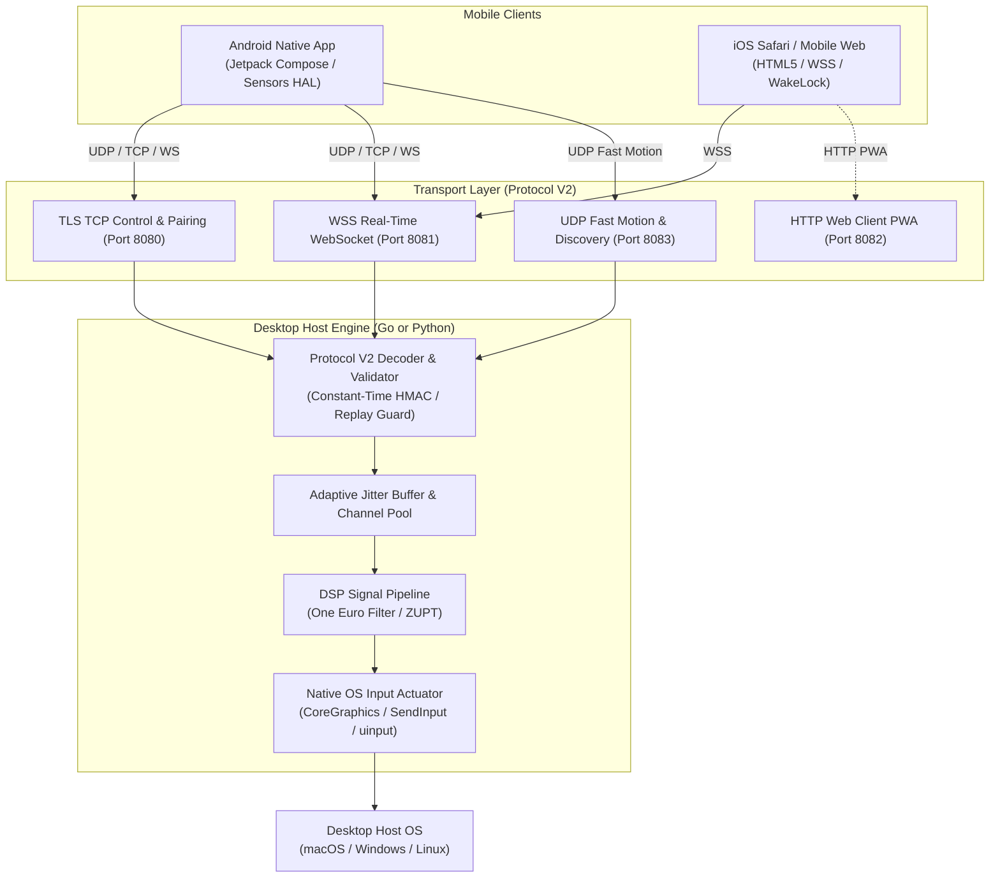

<div align="center">


# 🖱️ AirMouse Pro (v1.0.1)
### Next-Generation Spatial Air Mouse, Multi-Touch Trackpad & Presentation Controller

[](https://github.com/tahamajs/AirMouse/releases/tag/v1.0.1)
[](https://pypi.org/project/airmouse-core/)
[](https://pypi.org/project/airmouse-core/)
[](https://go.dev/)
[-3DDC84?logo=android)](https://developer.android.com)
[](docs/AUDIT_4_WEB_CLIENT_CROSS_BROWSER.md)
[](docs/PROTOCOL_V2.md)
[](android/docs/R8_OPTIMIZATION.md)
[](LICENSE)

<br/>

[**Downloads**](#-official-releases--downloads-all-platforms) •
[**Quickstart**](#-quickstart--getting-started) •
[**Subsystems Breakdown**](#-comprehensive-subsystems-breakdown) •
[**Architecture**](#-system-architecture) •
[**Protocol V2 Wire Spec**](#-canonical-protocol-v2-wire-envelope) •
[**OS Setup Guides**](#-operating-system-setup-guides) •
[**Single Source of Truth**](#-single-source-of-truth-ssot-versioning) •
[**Audits & Technical Reports**](#-deep-audits--technical-reports)

</div>

---

## 📖 Overview

**AirMouse Pro** is an ultra-low-latency, cross-platform spatial input synthesis ecosystem that transforms smartphones and mobile devices into precision desktop controllers. It seamlessly combines:
1. **6-DOF Spatial Air Mouse**: Move the desktop cursor with natural wrist motion using digital signal processing (One Euro Filter + ZUPT drift suppression).
2. **Multi-Touch Virtual Trackpad**: Smooth kinetic scrolling, 1/2/3-finger gestures, and tactile haptic clicks.
3. **Presentation & Media Remote**: Next/previous slide transitions, virtual laser pointer overlays, and volume dials.
4. **Zero-Install Web Client**: Instant connectivity for iPhone/iPad (iOS Safari) and mobile browsers without App Store installation.

---

## 📦 Official Releases & Downloads (All Platforms)

Download pre-compiled, signed, production-ready release packages for version **v1.0.1**:

| Platform | Target Architecture | Release Artifact | Quick Installation |
| :--- | :--- | :--- | :--- |
| **🤖 Android** | ARM64 / ARMv7 / x86_64 | [**`AirMouse-v1.0.1.apk`**](https://github.com/tahamajs/AirMouse/releases/download/v1.0.1/AirMouse-v1.0.1.apk) | `adb install -r AirMouse-v1.0.1.apk` |
| **🪟 Windows** | x86_64 (Windows 10/11) | [**`AirMouse-v1.0.1-windows-x64.zip`**](https://github.com/tahamajs/AirMouse/releases/download/v1.0.1/AirMouse-v1.0.1-windows-x64.zip) | Extract & run `Start-AirMouse.bat` |
| **🪟 Windows** | x86_64 Portable EXE | [**`AirMouse-Server-v1.0.1-windows-x64.exe`**](https://github.com/tahamajs/AirMouse/releases/download/v1.0.1/AirMouse-Server-v1.0.1-windows-x64.exe) | Standalone zero-dependency executable |
| **🍎 macOS** | Universal (Apple Silicon M1-M4 + Intel) | [**`AirMouse-v1.0.1-macos-universal.tar.gz`**](https://github.com/tahamajs/AirMouse/releases/download/v1.0.1/AirMouse-v1.0.1-macos-universal.tar.gz) | Extract & run `AirMouse.app` |
| **🍎 macOS** | Universal CLI Daemon | [**`AirMouse-Server-v1.0.1-macos-universal`**](https://github.com/tahamajs/AirMouse/releases/download/v1.0.1/AirMouse-Server-v1.0.1-macos-universal) | Standalone Mach-O Universal binary |
| **🐧 Linux** | x86_64 (Ubuntu/Debian/Fedora/Arch) | [**`AirMouse-v1.0.1-linux-x64.tar.gz`**](https://github.com/tahamajs/AirMouse/releases/download/v1.0.1/AirMouse-v1.0.1-linux-x64.tar.gz) | Extract & run `./start-airmouse.sh` |
| **🐧 Linux** | ARM64 (Raspberry Pi 4/5 / SBC) | [**`AirMouse-v1.0.1-linux-arm64.tar.gz`**](https://github.com/tahamajs/AirMouse/releases/download/v1.0.1/AirMouse-v1.0.1-linux-arm64.tar.gz) | Extract & run `./start-airmouse.sh` |

> 🔐 **Checksums**: Verify package integrity using [**`releases/SHA256SUMS.txt`**](https://github.com/tahamajs/AirMouse/releases/download/v1.0.1/SHA256SUMS.txt).
> 
> ⚡ **Rebuild All Releases from Source**: Run [`./scripts/build_all_releases.sh`](scripts/build_all_releases.sh) to regenerate all binaries and archives.

---

## 📱 Application UI & Design Showcase

<div align="center">
  
  <p><em>Figure 1: AirMouse Android Client — <b>Touchpad &amp; Live Stats</b>, <b>ZUPT Sensor Calibration</b>, and <b>One Euro Filter Customization</b></em></p>
</div>

<br/>

<div align="center">
  
  <p><em>Figure 2: AirMouse Desktop Host Server — <b>6-Tab Fyne GUI Dashboard</b> with Live Waveform &amp; Jitter Analytics</em></p>
</div>

---

## 🧩 Comprehensive Subsystems Breakdown

AirMouse Pro is structured into four primary engineering modules:

```
AirMouse/
├── android/            # Native Android Client (Kotlin, Jetpack Compose M3, Hilt, Room, R8)
├── pc/
│   ├── airmouse_go_new/# Go High-Performance Server (Zero-CGO, native OS input synthesis)
│   └── airmouse_py/    # Python Reference Server (Asyncio, pynput, PyPI package)
├── web-client/         # Zero-Install Mobile Web Client (iOS Safari / PWA / Web Audio)
├── packaging/          # Linux udev rules, systemd services, and desktop shortcuts
└── scripts/            # Single Source of Truth versioning and automated release builders
```

### 1. 🤖 Android Native Client (`android/`)
* **Jetpack Compose Material 3 UI**: Modern dark theme with spring physics, custom dials, and glassmorphic surface cards.
* **Telemetry Isolation**: High-frequency sensor streams (100 Hz) are decoupled from the root composables into leaf components (`IsolatedOrientationTelemetry`, `ConnectionQualityPill`, `TouchPointsOverlay`) to prevent frame drops on 90Hz/120Hz displays.
* **Sensor Fusion DSP**:
  * **One Euro Filter**: Non-linear adaptive low-pass filter ($f_c = f_{c_{min}} + \beta |\dot{x}|$) eliminating micro-jitter during slow precision aiming while providing instant response during fast flicks.
  * **ZUPT (Zero-Velocity Update)**: Autonomous drift cancellation recalibrating gyroscope bias during stationary intervals.
* **Robust Background Service (`AirMouseService.kt`)**: Android Foreground Service with strict 2-hour WakeLock timeout and automatic lifecycle unbinding.
* **Backpressure Management**: All high-frequency Kotlin `Flow` streams utilize `buffer(64, BufferOverflow.DROP_OLDEST)` to prevent Out-Of-Memory (OOM) errors and GC pauses.
* **R8 Optimization**: Fully shrunk with R8 Full Mode, reducing uncompressed DEX from **58.6 MB down to 6.83 MB (-88.3%)** with **92.2% obfuscation**.

### 2. ⚡ Go Desktop Server (`pc/airmouse_go_new/`)
* **Zero-CGO Native OS Input Injection**:
  * **macOS**: Synthesizes native CoreGraphics events (`CGEventCreateMouseEvent`, `CGEventPost`) via direct syscalls without CGO compilation overhead.
  * **Windows**: Injects hardware mouse and keyboard events using `user32.dll` `SendInput`.
  * **Linux**: Communicates directly with `/dev/uinput` to provide true kernel-level virtual mouse/keyboard emulation compatible with both Wayland and X11.
* **High-Throughput Concurrency**:
  * Bounded worker pool with non-blocking `SafeSend` and panic recovery to isolate slow clients.
  * Graceful shutdown on `SIGINT`/`SIGTERM` with 5-second drain timeout.
  * Dynamic configuration reloading via `SIGHUP`.
* **Fyne GUI Dashboard**: 6-tab native desktop dashboard displaying live jitter analytics, client pairing, QR codes, and latency histograms.

### 3. 🐍 Python Core Server (`pc/airmouse_py/`)
* **PyPI Availability**: Installable via `pip install airmouse-core`.
* **Asynchronous Networking**: Built on Python `asyncio` handling TLS TCP, WebSockets, and UDP broadcast discovery.
* **Decoupled Actuator Thread (`MouseActuatorThread`)**: Offloads OS mouse operations to a dedicated worker thread with a thread-safe `queue.Queue` and non-blocking timers (`threading.Timer`) for click actions, preventing event loop starvation.
* **Interactive Terminal CLI**: Features an ANSI QR code generator for instant mobile camera pairing.

### 4. 🌐 Zero-Install Mobile Web Client (`web-client/`)
* **iOS 13+ User-Gesture Modal**: Prompts the user with a glassmorphic onboarding dialog to satisfy Apple's strict `DeviceMotionEvent.requestPermission()` requirement.
* **Pooled Web Audio Click Synthesis**: Pre-synthesizes three band-limited PCM audio impulses (14ms, 24ms, 38ms) and pre-warms the WebKit audio pipeline on first touch to deliver zero-latency clicks on iOS where vibration is blocked.
* **Screen Wake Lock Fallback**: Uses the W3C Screen Wake Lock API on modern browsers and falls back to an invisible looping base64 video container for older iOS Safari versions.
* **2D Orientation Matrix**: Automatically transforms gyro delta vectors when switching between portrait and landscape modes:
  $$\begin{pmatrix} \text{rotDx} \\ \text{rotDy} \end{pmatrix} = \begin{pmatrix} \cos\theta & \sin\theta \\ -\sin\theta & \cos\theta \end{pmatrix} \begin{pmatrix} \Delta\gamma \\ \Delta\beta \end{pmatrix}$$

---

## 🏗️ System Architecture



---

## 📡 Canonical Protocol V2 Wire Envelope

All communication across TCP, WebSocket, and UDP adheres to the hardened **Protocol V2** envelope:

```json
{
  "v": 2,
  "type": "move",
  "seq": 10429,
  "ts": 1729858291042,
  "id": "f47ac10b-58cc-4372-a567-0e02b2c3d479",
  "token": "a6c8e3f...",
  "payload": {
    "dx": -3.42,
    "dy": 1.18,
    "dt": 0.016
  }
}
```

### Supported Message Catalog:
| Type | Description | Key Payload Attributes |
|---|---|---|
| `hello` | Handshake initiation & client identity | `name`, `model`, `version`, `protocol`, `token` |
| `welcome` | Handshake approval & server metadata | `session_id`, `heartbeat_ms`, `capabilities` |
| `move` | High-frequency cursor displacement | `dx` (-500 to 500), `dy` (-500 to 500), `dt` |
| `click` | Mouse button press/release/click | `button` (`left`, `right`, `middle`, `double`) |
| `scroll` | Vertical or horizontal scroll wheel | `delta` (-10.0 to 10.0) |
| `gesture` | 3D spatial motion gesture triggers | `name` (`circle`, `swipe_left`, `shake`), `confidence` |
| `proximity` | Hover and device approach data | `state`, `distance_cm`, `hover_active` |
| `control` | System & presentation shortcuts | `action` (`presentation_next`, `presentation_blackout`) |
| `ack` | Delivery acknowledgement | `ack_id`, `status` (`ok`) |
| `ping`/`pong`| Round-trip latency calculation | Empty payload |

---

## 💻 Operating System Setup Guides

### 🍎 macOS Setup
1. **Accessibility Permissions**: macOS requires Accessibility permissions to synthesize mouse events:
   - Open **System Settings $\rightarrow$ Privacy & Security $\rightarrow$ Accessibility**.
   - Enable `AirMouse.app` or `AirMouse-Server`.
2. **Gatekeeper Notice**: For downloaded Universal binaries:
   ```bash
   xattr -cr /Applications/AirMouse.app
   ```
3. Run the application or standalone binary:
   ```bash
   ./AirMouse-Server-v1.0.1-macos-universal
   ```

### 🪟 Windows Setup
1. Extract `AirMouse-v1.0.1-windows-x64.zip`.
2. Double-click `Start-AirMouse.bat` (Window mode) or `Start-AirMouse-Console.bat` (Console mode).
3. **Firewall**: On first launch, Windows Defender Firewall will prompt to allow network access. Allow access on private networks.

### 🐧 Linux Setup (uinput without root)
AirMouse uses the Linux kernel's `/dev/uinput` subsystem for input synthesis.
1. Install the provided udev rule:
   ```bash
   sudo cp packaging/udev/99-airmouse-uinput.rules /etc/udev/rules.d/
   ```
2. Add your user to the `input` group:
   ```bash
   sudo usermod -aG input $USER
   ```
3. Reload rules:
   ```bash
   sudo udevadm control --reload-rules && sudo udevadm trigger
   ```
4. Run the server:
   ```bash
   ./airmouse-server-v1.0.1-linux-x64
   ```
*(For detailed steps, see [**`docs/LINUX_SETUP.md`**](docs/LINUX_SETUP.md))*

---

## 🔄 Single Source of Truth (SSOT) Versioning

Like enterprise open-source projects (Docker, Kubernetes, VS Code), AirMouse manages its versioning through a single canonical file:
* **Canonical Version File**: [`VERSION`](VERSION) (e.g. `1.0.1`)
* **Unified Bumping Script**: [`scripts/bump_version.py`](scripts/bump_version.py)

### How to Bump or Sync Versions:
```bash
# 1. Bump version across all 19 target files (Android, Go, Python, Web, Docs)
python3 scripts/bump_version.py 1.0.2

# 2. Check for version drift in CI
python3 scripts/bump_version.py --check

# 3. Dry-run preview
python3 scripts/bump_version.py --dry-run 1.0.2
```

---

## 📊 Deep Audits & Technical Reports

The codebase has undergone comprehensive architectural, cryptographic, and performance audits. Read the detailed reports in `docs/`:

1. [**docs/AUDIT_1_SYSTEM_ARCHITECTURE_PROTOCOL.md**](docs/AUDIT_1_SYSTEM_ARCHITECTURE_PROTOCOL.md): Protocol V2 wire format, JSON vs binary framing, monotonic sequence hazards, and multiplatform sync.
2. [**docs/AUDIT_2_ANDROID_CLIENT_DEEP_DIVE.md**](docs/AUDIT_2_ANDROID_CLIENT_DEEP_DIVE.md): Jetpack Compose recomposition elimination, One Euro Filter tuning, and WakeLock power management.
3. [**docs/AUDIT_3_DESKTOP_DAEMONS_GO_AND_PYTHON.md**](docs/AUDIT_3_DESKTOP_DAEMONS_GO_AND_PYTHON.md): Low-level OS input injection (CGEvent, SendInput, uinput), Wayland security models, and Python asyncio concurrency.
4. [**docs/AUDIT_4_WEB_CLIENT_CROSS_BROWSER.md**](docs/AUDIT_4_WEB_CLIENT_CROSS_BROWSER.md): iOS Safari WebKit sandbox constraints, DeviceMotionEvent permissions, Web Audio tactile impulses, and Screen Wake Lock fallbacks.
5. [**docs/AUDIT_5_SECURITY_DEVOPS_ROADMAP.md**](docs/AUDIT_5_SECURITY_DEVOPS_ROADMAP.md): Cryptographic threat modeling, timing attack remediation, and prioritized P0–P3 roadmap.
6. [**android/docs/R8_OPTIMIZATION.md**](android/docs/R8_OPTIMIZATION.md): R8 Full Mode verification metrics, reducing DEX by 88.3% to 6.83 MB.
7. [**docs/LINUX_SETUP.md**](docs/LINUX_SETUP.md): Comprehensive Linux uinput and udev guide.

---

## 🧪 Testing and Quality Verification

AirMouse maintains automated test suites across all layers:

- **Go Test Suite (`pc/airmouse_go_new`)**:
  ```bash
  cd pc/airmouse_go_new && go test ./...
  # Result: 100% Pass across all 22 packages
  ```
- **Python Test Suite (`pc/airmouse_py`)**:
  ```bash
  pytest pc/airmouse_py/tests/
  # Result: 68/68 passed in 4.6s (100% Pass Rate)
  ```
- **Android Quality Verification**:
  ```bash
  cd android && ./gradlew testDebugUnitTest
  # Result: 100% pass rate
  ```

---

## 🛡️ License

This project is licensed under the [MIT License](LICENSE).  
Copyright (c) 2026 Taha Majs & Contributors.
