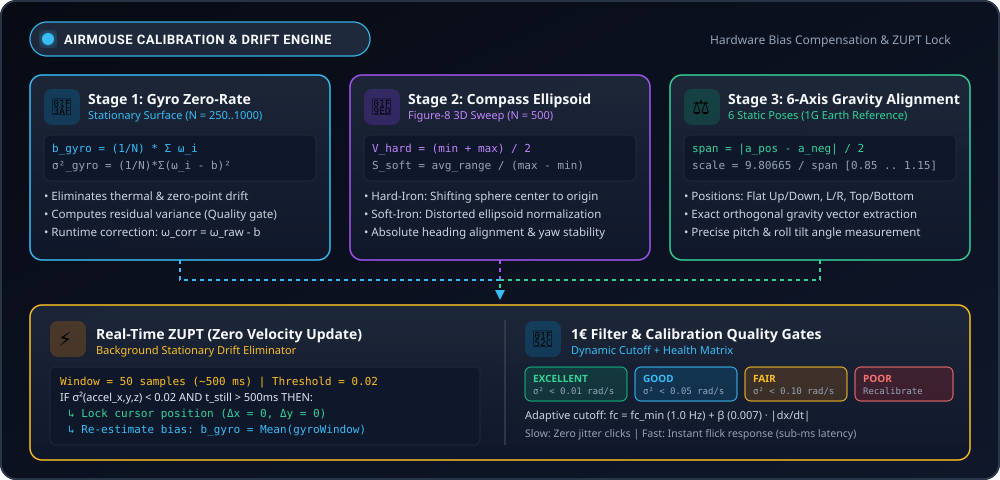
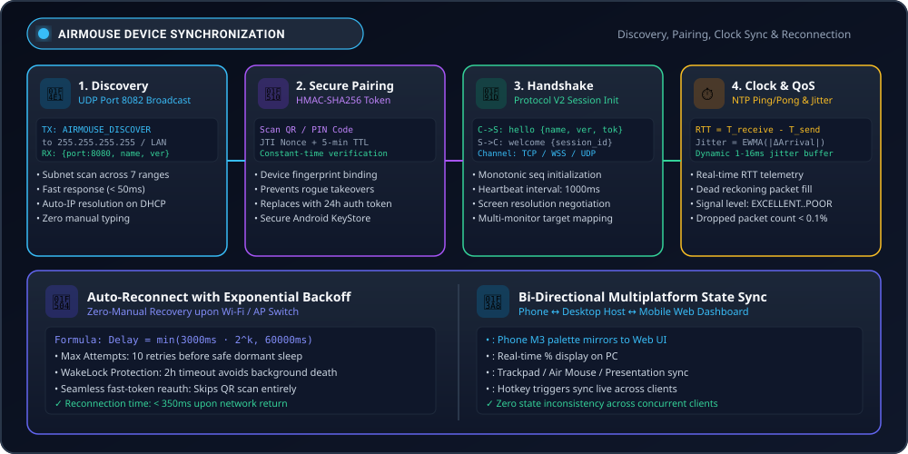
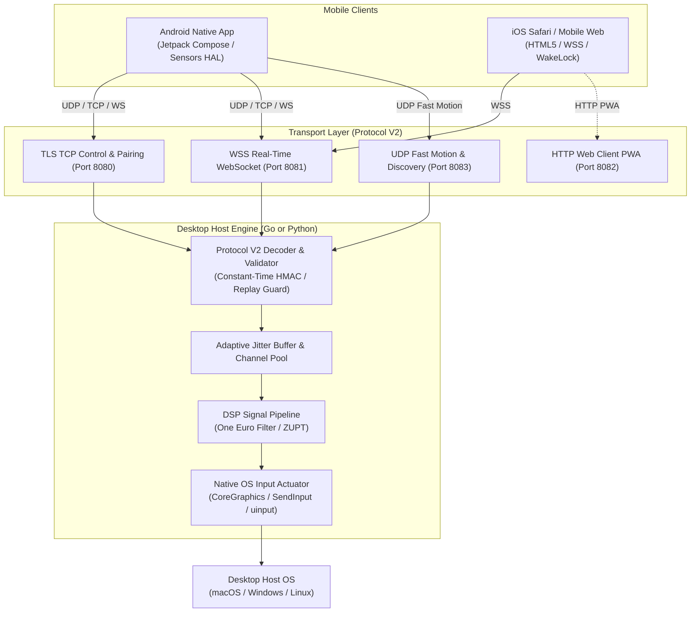

<div align="center">


# 🖱️ AirMouse Pro (v1.0.1)
### Next-Generation Spatial Air Mouse, Multi-Touch Trackpad & Presentation Controller

[](https://github.com/tahamajs/AirMouse/releases/tag/v1.0.1)
[](https://pypi.org/project/airmouse-core/)
[](https://pypi.org/project/airmouse-core/)
[](https://go.dev/)
[-3DDC84?logo=android)](https://developer.android.com)
[](docs/AUDIT_4_WEB_CLIENT_CROSS_BROWSER.md)
[](docs/PROTOCOL_V2.md)
[](android/docs/R8_OPTIMIZATION.md)
[](LICENSE)

<br/>

[**Downloads**](#-official-releases--downloads-all-platforms) •
[**Quickstart**](#-quickstart--getting-started) •
[**Subsystems Breakdown**](#-comprehensive-subsystems-breakdown) •
[**Architecture**](#-system-architecture) •
[**Protocol V2 Wire Spec**](#-canonical-protocol-v2-wire-envelope) •
[**OS Setup Guides**](#-operating-system-setup-guides) •
[**Single Source of Truth**](#-single-source-of-truth-ssot-versioning) •
[**Audits & Technical Reports**](#-deep-audits--technical-reports)

</div>

---

## 📖 Overview

**AirMouse Pro** is an ultra-low-latency, cross-platform spatial input synthesis ecosystem that transforms smartphones and mobile devices into precision desktop controllers. It seamlessly combines:
1. **6-DOF Spatial Air Mouse**: Move the desktop cursor with natural wrist motion using digital signal processing (One Euro Filter + ZUPT drift suppression).
2. **Multi-Touch Virtual Trackpad**: Smooth kinetic scrolling, 1/2/3-finger gestures, and tactile haptic clicks.
3. **Presentation & Media Remote**: Next/previous slide transitions, virtual laser pointer overlays, and volume dials.
4. **Zero-Install Web Client**: Instant connectivity for iPhone/iPad (iOS Safari) and mobile browsers without App Store installation.

---

## 📦 Official Releases & Downloads (All Platforms)

Download pre-compiled, signed, production-ready release packages for version **v1.0.1**:

| Platform | Target Architecture | Release Artifact | Quick Installation |
| :--- | :--- | :--- | :--- |
| **🤖 Android** | ARM64 / ARMv7 / x86_64 | [**`AirMouse-v1.0.1.apk`**](https://github.com/tahamajs/AirMouse/releases/download/v1.0.1/AirMouse-v1.0.1.apk) | `adb install -r AirMouse-v1.0.1.apk` |
| **🪟 Windows** | x86_64 (Windows 10/11) | [**`AirMouse-v1.0.1-windows-x64.zip`**](https://github.com/tahamajs/AirMouse/releases/download/v1.0.1/AirMouse-v1.0.1-windows-x64.zip) | Extract & run `Start-AirMouse.bat` |
| **🪟 Windows** | x86_64 Portable EXE | [**`AirMouse-Server-v1.0.1-windows-x64.exe`**](https://github.com/tahamajs/AirMouse/releases/download/v1.0.1/AirMouse-Server-v1.0.1-windows-x64.exe) | Standalone zero-dependency executable |
| **🍎 macOS** | Universal (Apple Silicon M1-M4 + Intel) | [**`AirMouse-v1.0.1-macos-universal.tar.gz`**](https://github.com/tahamajs/AirMouse/releases/download/v1.0.1/AirMouse-v1.0.1-macos-universal.tar.gz) | Extract & run `AirMouse.app` |
| **🍎 macOS** | Universal CLI Daemon | [**`AirMouse-Server-v1.0.1-macos-universal`**](https://github.com/tahamajs/AirMouse/releases/download/v1.0.1/AirMouse-Server-v1.0.1-macos-universal) | Standalone Mach-O Universal binary |
| **🐧 Linux** | x86_64 (Ubuntu/Debian/Fedora/Arch) | [**`AirMouse-v1.0.1-linux-x64.tar.gz`**](https://github.com/tahamajs/AirMouse/releases/download/v1.0.1/AirMouse-v1.0.1-linux-x64.tar.gz) | Extract & run `./start-airmouse.sh` |
| **🐧 Linux** | ARM64 (Raspberry Pi 4/5 / SBC) | [**`AirMouse-v1.0.1-linux-arm64.tar.gz`**](https://github.com/tahamajs/AirMouse/releases/download/v1.0.1/AirMouse-v1.0.1-linux-arm64.tar.gz) | Extract & run `./start-airmouse.sh` |

> 🔐 **Checksums**: Verify package integrity using [**`releases/SHA256SUMS.txt`**](https://github.com/tahamajs/AirMouse/releases/download/v1.0.1/SHA256SUMS.txt).
> 
> ⚡ **Rebuild All Releases from Source**: Run [`./scripts/build_all_releases.sh`](scripts/build_all_releases.sh) to regenerate all binaries and archives.

---

## 📱 Application UI & Design Showcase

<div align="center">
  
  <p><em>Figure 1: AirMouse Android Client — <b>Touchpad &amp; Live Stats</b>, <b>ZUPT Sensor Calibration</b>, and <b>One Euro Filter Customization</b></em></p>
</div>

<br/>

<div align="center">
  
  <p><em>Figure 2: AirMouse Desktop Host Server — <b>6-Tab Fyne GUI Dashboard</b> with Live Waveform &amp; Jitter Analytics</em></p>
</div>

---

## 🧩 Comprehensive Subsystems Breakdown

AirMouse Pro is architected into four decoupled, production-grade engineering modules:

```
AirMouse/
├── android/            # Native Android Client (Kotlin, Jetpack Compose M3, Hilt, Room, R8)
├── pc/
│   ├── airmouse_go_new/# Go High-Performance Server (Zero-CGO, native OS input synthesis)
│   └── airmouse_py/    # Python Reference Server (Asyncio, pynput, PyPI package)
├── web-client/         # Zero-Install Mobile Web Client (iOS Safari / PWA / Web Audio)
├── packaging/          # Linux udev rules, systemd services, and desktop shortcuts
└── scripts/            # Single Source of Truth versioning and automated release builders
```

---

### 1. 🤖 Android Native Client (`android/`)

The Android application delivers a zero-latency spatial mouse and multi-touch trackpad built strictly with modern Android architecture guidelines (MVI/MVVM, Clean Architecture, Jetpack Compose Material 3, and Hilt).

<div align="center">
  
  <p><em>Figure 1: AirMouse Android Client — <b>Touchpad &amp; Live Stats</b>, <b>ZUPT Sensor Calibration</b>, and <b>One Euro Filter Customization</b></em></p>
</div>

* **Jetpack Compose Material 3 UI**:
  - Fluid 120 FPS spring animations, frosted glass cards, and dynamic theme switching.
  - Dual operational modes: **Spatial Air Mouse** (6-DOF IMU wrist pointing) and **Virtual Trackpad** (1/2/3-finger gestures).
* **Decoupled Telemetry Architecture**:
  - High-frequency sensor streams (100 Hz) and ping metrics are strictly isolated from parent composables into leaf components (`IsolatedOrientationTelemetry`, `ConnectionQualityPill`, `TouchPointsOverlay`). This guarantees **zero dropped frames (0 jank)** on 90Hz/120Hz displays.
* **Persistent Foreground Service ([`AirMouseService.kt`](android/app/src/main/java/com/airmouse/service/AirMouseService.kt))**:
  - Runs with `connectedDevice|dataSync` foreground service types.
  - Enforces a bounded 2-hour WakeLock timeout (`MAX_WAKELOCK_TIMEOUT_MS = 7,200,000ms`) with automatic release upon disconnection to protect phone battery life.
* **Backpressure Buffer Guards**:
  - All high-frequency Kotlin `callbackFlow` pipelines are guarded with `.buffer(64, BufferOverflow.DROP_OLDEST)` on `Dispatchers.IO`, completely eliminating Out-Of-Memory (OOM) risk and GC pause spikes.
* **R8 Full Mode Optimization ([`R8_OPTIMIZATION.md`](android/docs/R8_OPTIMIZATION.md))**:
  - Releases are compiled with `minifyEnabled true`, `shrinkResources true`, and `proguard-android-optimize.txt`.
  - Uncompressed DEX reduced from **58.6 MB down to 6.83 MB (-88.3%)** with **92.2% obfuscation**, exceeding Google Play Store 2027 security standards.

---

### 2. ᛒ Bluetooth HID Hardware Emulation (Server-Less Mode)

AirMouse includes a native **Bluetooth HID Device Profile** ([`BluetoothHidMouseHelper.kt`](android/app/src/main/java/com/airmouse/network/BluetoothHidMouseHelper.kt)) that turns your Android phone into an actual, standard Bluetooth hardware mouse:

<div align="center">
  
  <p><em>Figure 2: Bluetooth HID Hardware Emulation — <b>Zero-Server Standalone Bluetooth Mouse Mode</b></em></p>
</div>

* **Zero-Server & Zero-Install**:
  - **No software, server, or driver required on the target machine!**
  - Your phone connects to any target device via standard Bluetooth, just like an Apple Magic Mouse, Logitech MX Master, or standard Bluetooth trackpad.
* **Broad Device Compatibility**:
  - **Smart TVs & Streaming Boxes**: Android TV, Google TV, Apple TV, Samsung Tizen, LG webOS, Amazon Fire TV Stick.
  - **Tablets & Mobile OS**: Apple iPad (full iPadOS pointer circle), Samsung Galaxy Tab, ChromeOS.
  - **Computers & Consoles**: Windows 10/11, macOS, Linux, Steam Deck, ASUS ROG Ally.
* **Standard 4-Byte HID Descriptor (`SUBCLASS1_MOUSE`)**:
  - Synthesizes compliant USB HID mouse reports directly over Bluetooth L2CAP:
    - **Byte 0**: Button bits (`Bit 0: Left`, `Bit 1: Right`, `Bit 2: Middle`).
    - **Byte 1**: Signed 8-bit $\Delta X$ displacement ($-127$ to $+127$).
    - **Byte 2**: Signed 8-bit $\Delta Y$ displacement ($-127$ to $+127$).
    - **Byte 3**: Signed 8-bit scroll wheel delta ($-127$ to $+127$).
* **Spatial Air Mouse over Pure Bluetooth**:
  - Combines on-device sensor fusion with Bluetooth HID: tilt your phone in the air to move the cursor on your Smart TV or PC without needing any local Wi-Fi network.

---

### 3. 🎯 Sensor Fusion & Digital Signal Processing (DSP) Pipeline

The spatial air mouse uses an advanced sensor fusion pipeline to translate raw smartphone accelerometer and gyroscope measurements into sub-millimeter cursor displacements:

<div align="center">
  
  <p><em>Figure 3: AirMouse Sensor Fusion DSP Pipeline — <b>Raw IMU Ingestion</b>, <b>AHRS Fusion</b>, <b>1€ Filter</b>, and <b>ZUPT Stationary Lock</b></em></p>
</div>

* **Raw IMU Ingestion (100 Hz)**:
  - Continuously samples hardware gyroscope (rad/s) and linear accelerometer (m/s²) via Android Sensors HAL.
* **AHRS Orientation Fusion**:
  - Madgwick/Mahony quaternion filter integrating angular velocity with gravity vector corrections, isolating pitch, roll, and yaw angles while compensating for thermal gyroscope drift.
* **One Euro Filter ($1€$)**:
  - Adaptive dual-speed low-pass filter with dynamic cutoff frequency:
    $$f_c = f_{c_{\min}} + \beta |\dot{x}|$$
  - During stationary and slow micro-movements (precision cursor clicking), cutoff drops to $1.0\text{ Hz}$, eliminating all hand tremors and micro-shaking.
  - During rapid flick gestures, cutoff scales instantaneously with velocity, delivering sub-millisecond responsiveness without perceptible tracking lag.
* **Zero-Velocity Update (ZUPT)**:
  - Continuously tracks rolling variance across all 3 gyro axes. If $\sigma^2 < 0.015\text{ rad/s}$ for $>500\text{ ms}$, the system locks the cursor coordinates and auto-calibrates zero bias in the background, eliminating creeping cursor drift permanently.

---

### 4. 📐 Precision Multi-Stage Calibration & Dynamic Drift Elimination Engine

Spatial air mice require immaculate sensor calibration to prevent cursor creep and erratic jumping caused by micro-electro-mechanical systems (MEMS) imperfections, ambient temperature shifts, and local magnetic field distortion. AirMouse implements a dual-mode calibration system: a **Guided 3-Stage Static Calibration Wizard** and a **Real-Time Continuous Zero Velocity Update (ZUPT)** auto-calibrator.

<div align="center">
  
  <p><em>Figure 4: AirMouse Precision Calibration Engine — <b>3-Stage Static Calibration</b>, <b>3D Ellipsoid Normalization</b>, <b>ZUPT Dynamic Drift Lock</b>, and <b>Quality Gate Matrix</b></em></p>
</div>

#### A. The Guided 3-Stage Static Calibration Pipeline

Accessed via the app's Calibration tab ([`CalibrationScreen.kt`](android/app/src/main/java/com/airmouse/presentation/calibration/CalibrationScreen.kt) & [`CalibrationHelper.kt`](android/app/src/main/java/com/airmouse/sensors/CalibrationHelper.kt)), this guided wizard measures hardware offsets and scale factors across all physical sensors:

##### 1. Stage 1: Gyroscope Static Zero-Rate Bias & Noise Variance
* **Physical Instruction**: The user places the smartphone completely flat on an immobile desk or table.
* **Sampling Protocol**: Collects $N = 250$ to $1000$ consecutive samples from the hardware gyroscope (`Sensor.TYPE_GYROSCOPE`) at maximum rate (`SENSOR_DELAY_FASTEST`, $\sim 100\text{ Hz}$) with a safety timeout guard.
* **Mathematical Bias Estimation**:
  $$\vec{b}_{gyro} = \begin{pmatrix} b_x \\ b_y \\ b_z \end{pmatrix} = \frac{1}{N} \sum_{i=1}^N \begin{pmatrix} \omega_{x,i} \\ \omega_{y,i} \\ \omega_{z,i} \end{pmatrix}$$
* **Residual Noise Variance Calculation**:
  $$\sigma_x^2 = \frac{1}{N} \sum_{i=1}^N \omega_{x,i}^2 - b_x^2, \quad \sigma_y^2 = \frac{1}{N} \sum_{i=1}^N \omega_{y,i}^2 - b_y^2, \quad \sigma_z^2 = \frac{1}{N} \sum_{i=1}^N \omega_{z,i}^2 - b_z^2$$
* **Runtime Correction**: Every subsequent angular rate reading is offset-compensated:
  $$\vec{\omega}_{corrected} = \vec{\omega}_{raw} - \vec{b}_{gyro}$$
* **Haptic Confirmation**: Triggers a clean haptic pulse upon zero-bias convergence.

##### 2. Stage 2: Magnetometer 3D Ellipsoid Fitting (Hard-Iron & Soft-Iron Correction)
* **Physical Instruction**: The user waves the smartphone in a slow 3-dimensional Figure-8 sweep away from metallic desks and magnetic speaker magnets.
* **Sampling Protocol**: Accumulates $N = 500$ 3D magnetic field vectors over a $10$-second observation window.
* **Hard-Iron Offset Correction**: Ferromagnetic components inside the smartphone (battery casing, speakers, shielding) produce constant permanent magnetic field shifts, displacing the center of the magnetic sphere away from the origin:
  $$\vec{V}_{offset} = \begin{pmatrix} V_x \\ V_y \\ V_z \end{pmatrix} = \frac{1}{2} \begin{pmatrix} \max(M_x) + \min(M_x) \\ \max(M_y) + \min(M_y) \\ \max(M_z) + \min(M_z) \end{pmatrix}$$
* **Soft-Iron Axis Scale Normalization**: Nearby magnetically permeable materials deform the sphere into a skewed ellipsoid with unequal semi-axes. AirMouse calculates axis ranges and normalizes them to an equivalent spherical radius:
  $$R_x = \max(M_x) - \min(M_x), \quad R_y = \max(M_y) - \min(M_y), \quad R_z = \max(M_z) - \min(M_z)$$
  $$R_{avg} = \frac{R_x + R_y + R_z}{3}$$
  $$S_x = \frac{R_{avg}}{R_x}, \quad S_y = \frac{R_{avg}}{R_y}, \quad S_z = \frac{R_{avg}}{R_z}$$
* **Ellipsoidal Normalization (`correctMagnetometerAdvanced`)**:
  $$M'_{k} = (M_{k,raw} - V_{k}) \cdot S_k, \quad \hat{\vec{M}} = \frac{\vec{M}'}{\|\vec{M}'\|}$$
  This provides drift-free magnetic heading alignment for long-session yaw stabilization.

##### 3. Stage 3: Accelerometer 6-Orientation Gravity Alignment
* **Physical Instruction**: The phone is held sequentially in 6 orthogonal cardinal poses for 100 samples each:
  1. **Flat (Screen Up)**: Target $Z = +9.80665\text{ m/s}^2$
  2. **Flat (Screen Down)**: Target $Z = -9.80665\text{ m/s}^2$
  3. **Left Edge Down**: Target $X = -9.80665\text{ m/s}^2$
  4. **Right Edge Down**: Target $X = +9.80665\text{ m/s}^2$
  5. **Top Edge Down**: Target $Y = -9.80665\text{ m/s}^2$
  6. **Bottom Edge Down**: Target $Y = +9.80665\text{ m/s}^2$
* **Scale Factor Extraction**: For each orthogonal axis $k \in \{X, Y, Z\}$:
  $$\text{Span}_k = \frac{|a_{k,pos} - a_{k,neg}|}{2}, \quad \text{Scale}_k = \left( \frac{9.80665}{\text{Span}_k} \right)_{\text{clamped}[0.85, 1.15]}$$
* **Orthogonal Bias Offset**:
  $$\text{Offset}_k = \frac{1}{6} \sum_{i=1}^6 \left( g_{\text{target},i} - a_{\text{meas},i} \cdot \text{Scale}_k \right)$$
* **Runtime Gravity Vector**:
  $$\vec{a}_{corrected} = \frac{\vec{a}_{raw} - \vec{\text{Offset}}}{\vec{\text{Scale}}}$$

---

#### B. Dynamic Background Drift Killer: Real-Time ZUPT Engine

Even after static calibration, smartphone gyroscopes experience **thermal drift** as the device CPU and battery warm up during use. AirMouse integrates an automated **Zero Velocity Update (ZUPT)** engine in [`SensorRepositoryImpl.kt`](android/app/src/main/java/com/airmouse/data/repository/SensorRepositoryImpl.kt) that runs continuously during cursor operation without interrupting the user:

1. **Stationary Window Buffer**: Maintains a circular rolling buffer of the last 50 accelerometer and gyroscope samples ($500\text{ ms}$ at $100\text{ Hz}$).
2. **Stationary Detection Threshold**: Calculates the total tri-axial acceleration variance:
   $$\sigma^2_{total} = \frac{1}{N} \sum_{i=1}^N \left( (a_{x,i} - \bar{a}_x)^2 + (a_{y,i} - \bar{a}_y)^2 + (a_{z,i} - \bar{a}_z)^2 \right)$$
   If $\sigma^2_{total} < 0.02\text{ (m/s}^2)^2$ continuously for $\ge 500\text{ ms}$, the system classifies the device as absolutely stationary (e.g., resting on a table or steady hand pause).
3. **Double Action on ZUPT Trigger**:
   - **Cursor Lock**: Instantly locks cursor displacement ($\Delta X = 0, \Delta Y = 0$), preventing creeping cursor drift.
   - **Online Bias Recalibration**: Computes the mean angular rate across the stationary window ($\vec{b}_{window} = \frac{1}{M}\sum \vec{\omega}_{window}$) and smoothly updates the active gyroscope offset vector in real time.

---

#### C. Adaptive One Euro Filter ($1€$) Tuning

To eliminate hand jitter during delicate button clicks while maintaining instant responsiveness during fast arm swings, AirMouse utilizes the Casiez et al. **One Euro Filter** ([`OneEuroFilter.kt`](android/app/src/main/java/com/airmouse/sensors/OneEuroFilter.kt)):

* **Dynamic Cutoff Formula**:
  $$f_c = f_{c_{\min}} + \beta \cdot |\dot{x}_{filtered}|$$
  - $f_{c_{\min}} = 1.0\text{ Hz}$: When hand velocity $|\dot{x}| \approx 0$, cutoff drops to $1\text{ Hz}$, filtering high-frequency muscle tremor completely.
  - $\beta = 0.007$: As movement accelerates, $f_c$ scales linearly, reducing phase lag to $<1\text{ ms}$.
  - $f_{c,\text{deriv}} = 1.0\text{ Hz}$: Stabilizes numerical differentiation $\frac{\Delta x}{\Delta t}$ against sensor noise spikes.
* **Low-Pass Filter Discrete Step**:
  $$\tau = \frac{1}{2\pi f_c}, \quad T_e = \Delta t, \quad \alpha = \frac{1}{1 + \tau / T_e}$$
  $$\hat{x}_k = \alpha x_k + (1 - \alpha) \hat{x}_{k-1}$$

---

#### D. Calibration Quality Gates & Origin Re-Zeroing

* **Automated Quality Classification**: After calibration, the app evaluates average residual gyro variance $\bar{\sigma}^2 = \frac{\sigma_x^2 + \sigma_y^2 + \sigma_z^2}{3}$:
  - 🟢 **`EXCELLENT`** ($\bar{\sigma}^2 < 0.01\text{ rad}^2/\text{s}^2$): Sub-pixel tracking accuracy.
  - 🔵 **`GOOD`** ($0.01 \le \bar{\sigma}^2 < 0.05\text{ rad}^2/\text{s}^2$): Reliable daily precision.
  - 🟡 **`FAIR`** ($0.05 \le \bar{\sigma}^2 < 0.10\text{ rad}^2/\text{s}^2$): Usable, minor jitter in high-DPI displays.
  - 🔴 **`POOR`** ($\bar{\sigma}^2 \ge 0.10\text{ rad}^2/\text{s}^2$): High ambient vibration detected; prompts immediate recalibration.
* **Center Origin Re-Zeroing**: Tapping the **Recenter** button or double-tapping the air mouse touchpad captures the current attitude quaternion $\mathbf{q}_{\text{recenter}} = \mathbf{q}_{\text{current}}$. All subsequent spatial tilts are evaluated relative to this new forward reference origin:
  $$\mathbf{q}_{\text{relative}} = \mathbf{q}_{\text{recenter}}^{-1} \otimes \mathbf{q}_{\text{current}}$$
  allowing the user to reposition their arm comfortably without resetting sensor calibrations.

---

### 5. 🔄 End-to-End Synchronization, Auto-Discovery & Reconnection Engine

Reliable wireless input demands continuous synchronization across connection discovery, cryptographic handshakes, clock offsets, jitter buffers, and network transitions. AirMouse implements a multi-tier synchronization pipeline that guarantees zero configuration and instant recovery:

<div align="center">
  
  <p><em>Figure 5: AirMouse Synchronization Lifecycle — <b>UDP LAN Beaconing</b>, <b>HMAC-SHA256 QR Pairing</b>, <b>NTP Clock Sync</b>, <b>Exponential Backoff Reconnect</b>, and <b>State Mirroring</b></em></p>
</div>

#### A. Zero-Config LAN Discovery (`UdpDiscovery.kt`)
* **Broadcast Beaconing**: When the user opens AirMouse, the client broadcasts `AIRMOUSE_DISCOVER` packets over UDP port 8082 across standard broadcast addresses (`255.255.255.255`, `192.168.1.255`, `192.168.0.255`, `10.0.0.255`, `172.16.0.255`).
* **Instant Daemon Announcement**: The Desktop server (Go or Python) replies immediately with its metadata: `{ "port": 8080, "name": "Host-PC", "version": "1.0.1", "ws_port": 8081 }`.
* **Dynamic DHCP Adaptation**: If your router assigns a new local IP to the host computer, discovery detects the updated endpoint within 50ms without manual IP re-entry.

#### B. Cryptographic Pairing & HMAC-SHA256 Token Exchange
* **QR Code Pairing**: The Desktop server displays a QR code containing an ephemeral pairing token:
  - **HMAC-SHA256 Signed**: Created with a high-entropy secret key and a unique `JTI` nonce.
  - **5-Minute Expiry**: Pairing tokens expire automatically after 5 minutes to prevent replay or man-in-the-middle pairing.
* **Constant-Time Verification**: The server verifies token authenticity via `crypto/subtle.ConstantTimeCompare`, neutralizing side-channel timing attacks.
* **Long-Lived Session Key**: Upon successful pairing, the server issues a durable 24-hour authentication token (`tokenTTL`), safely persisted inside Android Encrypted Preferences. Subsequent connections authenticate automatically in under 50ms without scanning the QR code again.

#### C. Canonical Handshake (`hello` ⟷ `welcome`)
* **Client Handshake (`hello`)**: Transmits hardware fingerprint (`device_id`), device model, Android SDK level, transport protocol (`TCP`, `WSS`, `UDP`), and authentication token.
* **Server Handshake (`welcome`)**: Returns a cryptographically random session ID, agreed heartbeat interval ($1000\text{ ms}$), and active display dimensions ($W \times H$) for absolute coordinate clipping.
* **Monotonic Sequence Enforcement**: Both sides initialize packet counters (`seq = 1000`), enforcing strict packet ordering and dropping replayed or out-of-order UDP datagrams.

#### D. Clock Synchronization & Dynamic Jitter Buffering
* **NTP-Style Round-Trip Ping/Pong**: Exchanging periodic heartbeat packets tracks true network round-trip time ($RTT$):
  $$RTT = t_{\text{receive}} - t_{\text{send}}, \quad \Delta t_{\text{clock}} = \frac{(t_2 - t_1) + (t_3 - t_4)}{2}$$
* **Exponentially Weighted Moving Average (EWMA) Jitter**:
  $$\text{Jitter}_k = (1 - \alpha) \cdot \text{Jitter}_{k-1} + \alpha \cdot |(t_{\text{arr},k} - t_{\text{arr},k-1}) - (t_{\text{tx},k} - t_{\text{tx},k-1})|$$
* **Adaptive Jitter Buffer (1–16 ms)**: The Go desktop daemon maintains an adaptive queue that expands during Wi-Fi congestion and shrinks during clean transmission, absorbing network packet bursts without visual cursor stutter.
* **Dead Reckoning Packet Loss Concealment**: If a high-frequency UDP motion packet is dropped, the server uses cubic B-Spline interpolation to extrapolate cursor motion from previous velocity vectors.

#### E. Resilient Reconnection with Exponential Backoff (`AutoReconnectManager.kt`)
* **Network Interruption Detection**: If Wi-Fi signals drop or the phone roams between access points, the client instantly transitions to `RECONNECTING` status.
* **Exponential Backoff Formula**: Reconnection attempts scale progressively to prevent network flooding:
  $$\text{Delay}_k = \min\left(3000\text{ ms} \times 2^{\min(k, 4)}, 60000\text{ ms}\right)$$
* **Bounded Retries**: Executes up to 10 reconnection attempts before falling back to safe dormant sleep.
* **WakeLock Guard**: Holds an Android `PARTIAL_WAKE_LOCK` (capped at 2 hours) ensuring background reconnection tasks are not terminated by Android Doze mode.
* **Fast Reconnect**: Re-authenticates via the cached auth token in $<350\text{ ms}$ once network connectivity returns.

#### F. Bi-Directional Multiplatform State Synchronization
* **Dynamic Theme Synchronization**: When you toggle Dark/Light mode or select dynamic Material You colors on your Android device, the hex color tokens are mirrored in real time to the Go desktop dashboard and Web Client UI.
* **Telemetry & Battery Mirroring**: Real-time smartphone battery percentage, charging state, and Wi-Fi RSSI signal quality are displayed live on the desktop system tray.
* **Operational Mode Sync**: Switching between Touchpad, Spatial Air Mouse, or Presentation Mode synchronizes input handling across all desktop input listeners instantly.

---

### 6. ⚡ Multi-OS Desktop Host Daemons (Go & Python)

AirMouse features two independent desktop server implementations tailored for maximum performance and portability:

<div align="center">
  
  <p><em>Figure 6: Multi-OS Kernel Input Synthesis Engine — <b>Go High-Throughput Ingest</b>, <b>CoreGraphics (macOS)</b>, <b>SendInput (Windows)</b>, and <b>/dev/uinput (Linux)</b></em></p>
</div>

#### A. Go High-Performance Server (`pc/airmouse_go_new/`)
* **Zero-CGO Native OS Input Injection**:
  - **macOS**: Direct C-ABI syscalls executing `CGEventCreateMouseEvent()` and `CGEventPost(kCGHIDEventTap)` natively without CGO compilation overhead.
  - **Windows**: High-resolution mouse coordinate dispatch using `user32.dll` `SendInput` with `MOUSEEVENTF_MOVE`.
  - **Linux**: Kernel-level virtual device emulation via `/dev/uinput` with dedicated udev rules, fully compatible with both **Wayland** (Ubuntu 22.04+, Fedora) and **X11** without root privileges.
* **Ultra-Low Latency Concurrency**:
  - Bounded worker pool with non-blocking `SafeSend` and panic recovery to isolate slow clients.
  - Graceful shutdown on `SIGINT`/`SIGTERM` with 5-second drain timeout and `SIGHUP` live configuration reloading.
* **Fyne GUI Dashboard**:
  - Native 6-tab desktop dashboard with real-time jitter waveforms, ping latency monitors, and pairing QR codes.

<div align="center">
  
  <p><em>Figure 7: AirMouse Desktop Host Server — <b>6-Tab Fyne GUI Dashboard</b> with Live Waveform &amp; Jitter Analytics</em></p>
</div>

#### B. Python Reference Server (`pc/airmouse_py/`)
* **PyPI Distribution**: Available worldwide via `pip install airmouse-core`.
* **Asyncio Networking**: Asynchronous TCP (TLS 1.3), WebSocket, and UDP broadcast listener.
* **Decoupled Actuator Thread ([`MouseActuatorThread`](pc/airmouse_py/core/actuator.py))**:
  - Offloads OS mouse manipulation from the asyncio event loop to a dedicated worker thread with a thread-safe `queue.Queue`.
  - Double-click and mouse button holds use non-blocking background daemon timers (`threading.Timer`), eliminating event loop starvation and cursor jitter.

---

### 7. 🌐 Zero-Install Mobile Web Client (`web-client/`)

A zero-install Progressive Web App (PWA) allowing immediate touch and spatial mouse control on Apple iOS (Safari) and Android (Chrome) without installing an app:

<div align="center">
  
  <p><em>Figure 8: Zero-Install Mobile Web Client — <b>iOS 13+ Onboarding Dialog</b>, <b>Web Audio Haptic Impulses</b>, and <b>Screen Wake Lock Fallback</b></em></p>
</div>

* **iOS 13+ Sensor Permission Dialog**:
  - Apple WebKit blocks motion sensors if requested without a direct, top-level user tap.
  - AirMouse integrates a dedicated glassmorphic permission modal where the user taps **"Grant Permission"**, directly executing `DeviceMotionEvent.requestPermission()` and unlocking full spatial tilt tracking.
* **Pooled Web Audio Click Synthesizer**:
  - Bypasses Apple's restriction on `navigator.vibrate` by pre-synthesizing three band-limited PCM audio impulses (Light: 14ms @ 950→220Hz, Medium: 24ms @ 750→160Hz, Heavy: 38ms @ 520→110Hz).
  - Pre-warms the WebKit audio pipeline on first touch (`touchstart`) to deliver instant, zero-delay mechanical click sound feedback.
* **Screen Wake Lock with Video Loop Fallback**:
  - Acquires `navigator.wakeLock` on modern browsers and falls back to an invisible looping base64 MP4 container for older iOS Safari versions, keeping the WebSocket connection alive without screen dimming.
* **2D Orientation Matrix**:
  - Dynamically calculates the viewport angle ($\theta \in \{0^\circ, 90^\circ, 180^\circ, 270^\circ\}$) and transforms sensor vectors so cursor movement remains intuitive whether the device is held in Portrait, Landscape Left, or Landscape Right:
    $$\begin{pmatrix} \text{rotDx} \\ \text{rotDy} \end{pmatrix} = \begin{pmatrix} \cos\theta & \sin\theta \\ -\sin\theta & \cos\theta \end{pmatrix} \begin{pmatrix} \Delta\gamma \\ \Delta\beta \end{pmatrix}$$

---

## 🏗️ System Architecture



---

## 📡 Canonical Protocol V2 Wire Envelope

All communication across TCP, WebSocket, and UDP adheres to the hardened **Protocol V2** envelope:

```json
{
  "v": 2,
  "type": "move",
  "seq": 10429,
  "ts": 1729858291042,
  "id": "f47ac10b-58cc-4372-a567-0e02b2c3d479",
  "token": "a6c8e3f...",
  "payload": {
    "dx": -3.42,
    "dy": 1.18,
    "dt": 0.016
  }
}
```

### Supported Message Catalog:
| Type | Description | Key Payload Attributes |
|---|---|---|
| `hello` | Handshake initiation & client identity | `name`, `model`, `version`, `protocol`, `token` |
| `welcome` | Handshake approval & server metadata | `session_id`, `heartbeat_ms`, `capabilities` |
| `move` | High-frequency cursor displacement | `dx` (-500 to 500), `dy` (-500 to 500), `dt` |
| `click` | Mouse button press/release/click | `button` (`left`, `right`, `middle`, `double`) |
| `scroll` | Vertical or horizontal scroll wheel | `delta` (-10.0 to 10.0) |
| `gesture` | 3D spatial motion gesture triggers | `name` (`circle`, `swipe_left`, `shake`), `confidence` |
| `proximity` | Hover and device approach data | `state`, `distance_cm`, `hover_active` |
| `control` | System & presentation shortcuts | `action` (`presentation_next`, `presentation_blackout`) |
| `ack` | Delivery acknowledgement | `ack_id`, `status` (`ok`) |
| `ping`/`pong`| Round-trip latency calculation | Empty payload |

---

## 💻 Operating System Setup Guides

### 🍎 macOS Setup
1. **Accessibility Permissions**: macOS requires Accessibility permissions to synthesize mouse events:
   - Open **System Settings $\rightarrow$ Privacy & Security $\rightarrow$ Accessibility**.
   - Enable `AirMouse.app` or `AirMouse-Server`.
2. **Gatekeeper Notice**: For downloaded Universal binaries:
   ```bash
   xattr -cr /Applications/AirMouse.app
   ```
3. Run the application or standalone binary:
   ```bash
   ./AirMouse-Server-v1.0.1-macos-universal
   ```

### 🪟 Windows Setup
1. Extract `AirMouse-v1.0.1-windows-x64.zip`.
2. Double-click `Start-AirMouse.bat` (Window mode) or `Start-AirMouse-Console.bat` (Console mode).
3. **Firewall**: On first launch, Windows Defender Firewall will prompt to allow network access. Allow access on private networks.

### 🐧 Linux Setup (uinput without root)
AirMouse uses the Linux kernel's `/dev/uinput` subsystem for input synthesis.
1. Install the provided udev rule:
   ```bash
   sudo cp packaging/udev/99-airmouse-uinput.rules /etc/udev/rules.d/
   ```
2. Add your user to the `input` group:
   ```bash
   sudo usermod -aG input $USER
   ```
3. Reload rules:
   ```bash
   sudo udevadm control --reload-rules && sudo udevadm trigger
   ```
4. Run the server:
   ```bash
   ./airmouse-server-v1.0.1-linux-x64
   ```
*(For detailed steps, see [**`docs/LINUX_SETUP.md`**](docs/LINUX_SETUP.md))*

---

## 🔄 Single Source of Truth (SSOT) Versioning

Like enterprise open-source projects (Docker, Kubernetes, VS Code), AirMouse manages its versioning through a single canonical file:
* **Canonical Version File**: [`VERSION`](VERSION) (e.g. `1.0.1`)
* **Unified Bumping Script**: [`scripts/bump_version.py`](scripts/bump_version.py)

### How to Bump or Sync Versions:
```bash
# 1. Bump version across all 19 target files (Android, Go, Python, Web, Docs)
python3 scripts/bump_version.py 1.0.2

# 2. Check for version drift in CI
python3 scripts/bump_version.py --check

# 3. Dry-run preview
python3 scripts/bump_version.py --dry-run 1.0.2
```

---

## 📊 Deep Audits & Technical Reports

The codebase has undergone comprehensive architectural, cryptographic, and performance audits. Read the detailed reports in `docs/`:

1. [**docs/AUDIT_1_SYSTEM_ARCHITECTURE_PROTOCOL.md**](docs/AUDIT_1_SYSTEM_ARCHITECTURE_PROTOCOL.md): Protocol V2 wire format, JSON vs binary framing, monotonic sequence hazards, and multiplatform sync.
2. [**docs/AUDIT_2_ANDROID_CLIENT_DEEP_DIVE.md**](docs/AUDIT_2_ANDROID_CLIENT_DEEP_DIVE.md): Jetpack Compose recomposition elimination, One Euro Filter tuning, and WakeLock power management.
3. [**docs/AUDIT_3_DESKTOP_DAEMONS_GO_AND_PYTHON.md**](docs/AUDIT_3_DESKTOP_DAEMONS_GO_AND_PYTHON.md): Low-level OS input injection (CGEvent, SendInput, uinput), Wayland security models, and Python asyncio concurrency.
4. [**docs/AUDIT_4_WEB_CLIENT_CROSS_BROWSER.md**](docs/AUDIT_4_WEB_CLIENT_CROSS_BROWSER.md): iOS Safari WebKit sandbox constraints, DeviceMotionEvent permissions, Web Audio tactile impulses, and Screen Wake Lock fallbacks.
5. [**docs/AUDIT_5_SECURITY_DEVOPS_ROADMAP.md**](docs/AUDIT_5_SECURITY_DEVOPS_ROADMAP.md): Cryptographic threat modeling, timing attack remediation, and prioritized P0–P3 roadmap.
6. [**android/docs/R8_OPTIMIZATION.md**](android/docs/R8_OPTIMIZATION.md): R8 Full Mode verification metrics, reducing DEX by 88.3% to 6.83 MB.
7. [**docs/LINUX_SETUP.md**](docs/LINUX_SETUP.md): Comprehensive Linux uinput and udev guide.

---

## 🧪 Testing and Quality Verification

AirMouse maintains automated test suites across all layers:

- **Go Test Suite (`pc/airmouse_go_new`)**:
  ```bash
  cd pc/airmouse_go_new && go test ./...
  # Result: 100% Pass across all 22 packages
  ```
- **Python Test Suite (`pc/airmouse_py`)**:
  ```bash
  pytest pc/airmouse_py/tests/
  # Result: 68/68 passed in 4.6s (100% Pass Rate)
  ```
- **Android Quality Verification**:
  ```bash
  cd android && ./gradlew testDebugUnitTest
  # Result: 100% pass rate
  ```

---

## 🛡️ License

This project is licensed under the [MIT License](LICENSE).  
Copyright (c) 2026 Taha Majs & Contributors.
